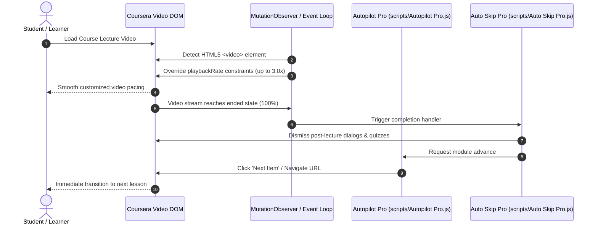

<div align="center">
  <h1>coursera-automation-suite</h1>
  <p>Tampermonkey userscript suite for Coursera video playback pacing, module navigation, and study automation.</p>

  <p>
    <a href="https://github.com/itsgoharrehman/coursera-automation-suite/releases"></a>
    <a href="LICENSE"></a>
    
    
    
    <a href="https://github.com/itsgoharrehman/coursera-automation-suite/stargazers"></a>
    <a href="https://github.com/itsgoharrehman/coursera-automation-suite/issues"></a>
  </p>
</div>

---

A modular Tampermonkey / Violentmonkey userscript automation suite engineered to enhance learning productivity on Coursera. Features automatic video completion detection, customizable playback speed normalizers, sequential module navigation, and note extraction helpers.

---

## Automation Flow and Execution Lifecycle



---

## Script Architecture and Module Breakdown

| Module | Location | Purpose & Capabilities |
| :--- | :--- | :--- |
| **Auto Skip Pro** | `scripts/Auto Skip Pro.js` | Listens for HTML5 video completion events, dismisses end-cards, and triggers next-lesson advancement |
| **Autopilot Pro** | `scripts/Autopilot Pro.js` | Automates course sequential flow, handles pausing prevention, and manages auto-resume across modules |
| **Bulk Completer** | `utils/Bulk Completer.js` | Scans reading assignments and automatically acknowledges completion |
| **Plain Copy** | `utils/Plain Copy.js` | Extracts clean lecture notes and transcripts without proprietary HTML container markup |
| **Quiz Prompt** | `quiz-prompt.md` | Structured prompt template for conceptual review and study synthesis |

---

## Repository Structure

```
coursera-automation-suite/
├── .github/
│   ├── ISSUE_TEMPLATE/
│   │   ├── bug_report.yml          # Structured bug reporting form
│   │   └── feature_request.yml     # Structured feature proposal form
│   ├── PULL_REQUEST_TEMPLATE.md    # Pull request security verification checklist
│   └── dependabot.yml              # Automated weekly npm scanner
├── scripts/
│   ├── Auto Skip Pro.js            # Video completion detector and skip engine
│   └── Autopilot Pro.js            # Sequential course progression automator
├── utils/
│   ├── Bulk Completer.js           # Reading assignment completion helper
│   ├── Plain Copy.js               # Clean text and transcript extractor
│   └── Quiz Solver.js              # Study and review utility
├── legacy/
│   └── Autopilot (Legacy).js       # Historical implementation archive
├── quiz-prompt.md                  # Conceptual review prompt guide
├── package.json                    # Project metadata
├── LICENSE                         # Educational Coursework License
├── SECURITY.md                     # Security policy and sandbox boundaries
├── CONTRIBUTING.md                 # Contribution guidelines
└── CODE_OF_CONDUCT.md             # Contributor Covenant v2.1
```

---

## Installation and Usage

### Prerequisites
* Tampermonkey or Violentmonkey extension installed in Chrome, Firefox, Safari, or Edge.

### Setup
1. Open the Tampermonkey dashboard.
2. Create a new script for each desired module from `scripts/` or `utils/`.
3. Copy the file contents into the editor and save.
4. Navigate to any enrolled course on `https://www.coursera.org/learn/*` and the scripts will initialize automatically.

---

## Security and Privacy Invariants

* **Zero Telemetry**: These scripts execute strictly within your local browser sandbox. They do not send telemetry, analytics, cookies, or credentials to third-party servers.
* **No Credential Access**: Scripts do not inspect or interact with login inputs, passwords, or authentication tokens.
* **Review Policy**: See [SECURITY.md](SECURITY.md) for vulnerability reporting.

---

## Disclaimer

This suite is developed for personal study pacing, accessibility, and productivity. Users are responsible for adhering to their institution's learning guidelines and course policies.

---

## License

Licensed under the [Educational Coursework License](LICENSE).
